Bem-vindo ao repositório do **Grupo 7** para a disciplina de Programação Orientada a Objetos.

Nosso projeto é o Astra: um sistema de gerenciamento e compra online para um cinema. O cliente pode consultar filmes e sessões disponíveis, selecionar assentos, comprar ingressos e adquirir produtos da bomboniere. O pagamento é realizado pelo sistema e os produtos e ingressos são retirados presencialmente no cinema. Funcionários administradores cadastram filmes, produtos da bomboniere e sessões de exibição. Todos os dados ficam salvos em um banco SQLite.

* [HTML da apresentação.](https://eumuno.github.io/poo-astra/apresentacao/)
* [HTML do JavaDoc](https://eumuno.github.io/poo-astra/docs/javadoc/)

---

## Integrantes do Grupo

* **Bruna Rosa Ferreira** — brunarf.aluno@unipampa.edu.br — [GitHub](https://github.com/eumuno)
* **Erik Bruckmann Soares** — eriksoares.aluno@unipampa.edu.br — [GitHub](https://github.com/Erikbruckmann1)
* **Gabriela Muniz Barreto** — gabrielamuniz.aluno@unipampa.edu.br — [GitHub](https://github.com/gabrielamnzb)
* **Isabeli Souza da Rosa** — isabelirosa.aluno@unipampa.edu.br — [GitHub](https://github.com/beliisa2626)
* **Katiane Gamarra Olegário** — katianeolegario.aluno@unipampa.edu.br — [GitHub](https://github.com/katianeG)

---

## Estrutura de Pastas do Repositório
 
A organização física das pastas do repositório segue as recomendações de boas práticas de engenharia de software:
 
```
poo-astra/
├── README.md                   # Esta página inicial do projeto.
├── docs/                       # Enunciados, capturas de tela (prints/), documentação JavaDoc em HTML (javadoc/) e o documento de segurança (SEGURANCA-STRIDE.md).
├── diagramas/                  # Pasta para os diagramas UML.
├── lib/                        # Bibliotecas externas (driver JDBC do SQLite e tema FlatLaf).
├── pom.xml                     # Configuração do Maven (dependências SQLite e FlatLaf).
└── src/                        # Pasta raiz do código-fonte.
    ├── astra/
    │   ├── modelo/             # Classes de domínio.
    │   ├── servico/            # Regras de negócio e lógicas do sistema.
    │   ├── excecoes/           # Classes de erros personalizados do domínio.
    │   ├── persistencia/       # Acesso ao banco de dados (ConexaoBanco).
    │   │   └── sql/            # schema.sql (tabelas) e seed.sql (dados iniciais).
    │   └── interfacegrafica/   # Telas desenvolvidas em Java Swing.
    └── teste/                  # Testes automáticos (cada classe tem um main e imprime "TODOS OS ... TESTES PASSARAM").
```
## Instruções para Executar o Projeto
 
Para testar o sistema Astra localmente, siga os passos abaixo:
1. Faça o clone deste repositório em sua máquina.
2. Tenha o **JDK 17 ou superior** instalado.
3. Abra o projeto em sua IDE de preferência (IntelliJ IDEA, Eclipse ou NetBeans), marcando a pasta `src` como raiz do código-fonte.
4. Adicione a pasta `lib/` como biblioteca do projeto. Ela já está no repositório e contém os dois `.jar` necessários:
   * `sqlite-jdbc-3.46.1.3.jar`: driver do banco SQLite (sem ele o sistema não abre);
   * `flatlaf-3.5.4.jar`: tema visual do Astra (sem ele a interface abre com o visual padrão do Java e o console mostra "FlatLaf não encontrado").
   Como adicionar:
   * **IntelliJ:** *File → Project Structure → Libraries → + → Java* e selecione a **pasta** `lib/` (assim os dois `.jar` entram de uma vez). Também dá para clicar com o botão direito na pasta `lib/` → *Add as Library*.
   * **Eclipse:** botão direito no projeto → *Build Path → Add External Archives* → selecione os dois `.jar` da pasta `lib/`.
   * **NetBeans:** *Libraries → Add JAR/Folder* → selecione os dois `.jar` da pasta `lib/`.
5. Execute a classe `astra.Main` (arquivo `src/astra/Main.java`) com a **raiz do projeto como diretório de trabalho** (padrão do IntelliJ).
6. Na primeira execução é criado o arquivo `astra.db` na raiz do projeto, com as tabelas e os dados iniciais. Nas próximas, os dados existentes são mantidos. Para recomeçar do zero, feche o programa e apague o `astra.db`.
7. A tela inicial (`AstraFrame`) será aberta. Você pode navegar entre a Área do Administrador (para cadastrar Filmes, Produtos e Sessões) e a Área do Cliente (para simular uma compra completa de ingressos e produtos da bomboniere, finalizando no pagamento).
**Pela linha de comando** (na raiz do projeto):
 
```bash
javac -encoding UTF-8 -d out $(find src -name "*.java")
```
 
```bash
java -cp "out:lib/*" astra.Main
```
 
No Windows, use `;` no lugar de `:` no classpath: `java -cp "out;lib/*" astra.Main`. As aspas são obrigatórias, para o `*` ser expandido pelo Java (incluindo todos os `.jar` da pasta `lib/`) e não pelo terminal.
 
Se o driver não estiver no classpath, o sistema mostra a mensagem "Não foi possível conectar ao banco de dados" e não abre. Se faltar o FlatLaf, o sistema abre, mas sem o tema do Astra.
 
**Alternativa com Maven** (precisa do Maven instalado; ele baixa as dependências do `pom.xml` sozinho, sem usar a pasta `lib/`):
 
```bash
mvn compile exec:java
```
 
## Banco de Dados
 
Usamos **SQLite** via JDBC: o banco é um único arquivo (`astra.db`), sem precisar instalar servidor.
 
* **`ConexaoBanco`** (`astra.persistencia`): ponto único de acesso ao banco. `abrirConexao()` devolve uma `Connection` com as chaves estrangeiras ligadas (`PRAGMA foreign_keys = ON`); `inicializar()` executa o `schema.sql` e, se o banco estiver vazio, o `seed.sql`, tudo em uma transação. A URL pode ser trocada com `-Dastra.banco.url=jdbc:sqlite:outro.db`.
* **`schema.sql`**: cria as 11 tabelas `usuario`, `filme`, `sala`, `assento`, `sessao`, `produto`, `pedido`, `item_pedido`, `ingresso`, `pagamento` e `auditoria` (registro das ações importantes, como logins, cadastros e compras). Os ids são gerados pelo banco (`AUTOINCREMENT`), os enums são gravados como texto (`name()`) com `CHECK` para aceitar só valores válidos, e as datas em ISO-8601 (`LocalDateTime.toString()`).
* **`seed.sql`**: dados iniciais usados na demonstração (um filme, um produto, a sala com 10 assentos e uma sessão, além de um administrador e um cliente).
* **`PersistenciaException`** (`astra.excecoes`): embrulha a `SQLException`, para que serviços e telas tratem erros de banco como as demais exceções do sistema.
* **`CriptografiaSenha`** (`astra.persistencia`): as senhas são gravadas como hash PBKDF2 (HMAC-SHA256) com um sal aleatório por senha, nunca em texto puro.
Regras garantidas pelo próprio banco:
* `UNIQUE(sessao_id, assento_id)` em `ingresso`: o mesmo assento não pode ser vendido duas vezes na mesma sessão.
* `CHECK (estoque >= 0)` em `produto`: o estoque nunca fica negativo.
* Chaves estrangeiras: não é possível, por exemplo, criar um pedido para um cliente que não existe.
Usuários iniciais (senha `123` para ambos): `admin@astra` (administrador) e `cliente@email.com` (cliente).
 
### Como usar o banco
 
**Onde fica:** o arquivo `astra.db` é criado na pasta de onde o programa é executado (no IntelliJ, a raiz do projeto). Ele está no `.gitignore`, então cada integrante tem o seu próprio banco local.
 
**Quando o `seed.sql` roda:** só na primeira execução, quando a tabela `usuario` ainda está vazia. Nas execuções seguintes o seed é ignorado, para não duplicar dados.
 
> ⚠️ Se você **alterar o `seed.sql`** (por exemplo, adicionar um filme), a mudança **não** entra em um `astra.db` que já existe. Para aplicar:
> 1. Feche o programa.
> 2. Apague o `astra.db` da raiz do projeto (`rm astra.db` no macOS/Linux, `del astra.db` no Windows).
> 3. Execute o `astra.Main` de novo. O banco é recriado com o schema e o seed atualizados.
>
> Isso apaga tudo o que foi gravado no banco local.
 
**Quando o `schema.sql` roda:** a cada execução, mas com `CREATE TABLE IF NOT EXISTS`. Uma tabela nova é criada normalmente. Já uma **mudança em tabela existente** (coluna nova, `CHECK` diferente) só vale depois de apagar o `astra.db`, como acima.
 
**Como ver os dados:**
* **Linha de comando** (o `sqlite3` já vem no macOS e na maioria das distribuições Linux):
```bash
sqlite3 astra.db
sqlite> .tables
sqlite> .headers on
sqlite> .mode column
sqlite> SELECT * FROM filme;
sqlite> .quit
```
* **IntelliJ:** abra a aba *Database → + → Data Source → SQLite*, aponte para o arquivo `astra.db` da raiz do projeto e, se o IntelliJ pedir, baixe o driver. Depois de rodar o programa, use *Refresh* para ver os dados atualizados.
* **Outra opção gráfica:** [DB Browser for SQLite](https://sqlitebrowser.org/).
**Usar outro arquivo de banco** (por exemplo, para testes sem mexer no seu `astra.db`): adicione `-Dastra.banco.url=jdbc:sqlite:teste.db` às *VM options* da configuração de execução no IntelliJ, ou rode pela linha de comando:
 
```bash
java -Dastra.banco.url=jdbc:sqlite:teste.db -cp "out:lib/*" astra.Main
```
 
**Problemas comuns:**
* *"Não foi possível conectar ao banco de dados"*: o `lib/sqlite-jdbc-3.46.1.3.jar` não está no classpath (veja o passo 4 das instruções de execução).
* *"FlatLaf não encontrado"* no console e telas com o visual padrão do Java: o `lib/flatlaf-3.5.4.jar` não está no classpath. Adicione a pasta `lib/` inteira como biblioteca (passo 4) ou use `-cp "out:lib/*"` na linha de comando.
* *"Script sql/schema.sql não encontrado"*: o programa não foi executado a partir da raiz do projeto. Ajuste o *Working directory* da configuração de execução para a pasta `poo-astra`.
* *Mudei o seed e nada aconteceu*: apague o `astra.db` (veja o aviso acima).
> **Estado atual:** filmes, produtos, sessões, usuários e pedidos são gravados e lidos do banco. As telas usam os serviços (`FilmeService`, `ProdutoService`, `SessaoService`, `VendaService`, `ContaService` e `PedidoService`), que dependem das interfaces de repositório e não do JDBC; o `Main` é o único lugar que cria as classes concretas. A `TelaCliente` conhece apenas a interface `CatalogoCliente`, e nenhuma tela importa classes de `persistencia`.
 
## Identificação das Classes Principais
 
O nosso domínio foi modelado para refletir a realidade de um cinema. As classes principais estão divididas em:
 
* **Atores:** `Usuario` (abstrata), `Cliente` e `Administrador`. Representam quem interage com o sistema.
* **Cinema:** `Filme`, `Sessao`, `Sala` e `Assento`. Representam a estrutura física e a programação.
* **Vendas:** `Produto`, `ItemPedido`, `Pedido` e `Ingresso`. Representam o ciclo de compras do cliente.
* **Pagamento:** `Pagamento` (abstrata), `PagamentoPix` e `PagamentoCartao`. Representam as diferentes formas de processar o acerto financeiro do pedido.
* **Serviços:** `FilmeService`, `ProdutoService` e `SessaoService` (cadastros do administrador), `VendaService` (montar o pedido e pagar), `ContaService` (entrar no sistema e criar conta), `PedidoService` (acompanhar e atualizar pedidos) e `AtendimentoCliente`, que implementa a interface `CatalogoCliente` com tudo o que a área do cliente pode fazer. Validam as regras de negócio e usam os repositórios (interfaces) para ler e gravar no banco.
* **Segurança e auditoria:** `ControleDeAcesso` (confere no banco se quem pede uma operação administrativa é mesmo administrador), `TrilhaDeAuditoria` e `RegistroDeAuditoria` (registram as ações importantes) e `AcessoNegadoException`.
## Explicação Breve das Regras de Negócio
 
O sistema não é apenas um cadastro; ele protege ativamente as seguintes regras de negócio:
* **Controle de Vagas:** Um assento não pode ser vendido se já estiver ocupado (dispara `AssentoIndisponivelException`).
* **Estoque:** Um pedido não é pago se algum produto não tiver estoque suficiente (dispara `EstoqueInsuficienteException`); o estoque é abatido na mesma transação que grava a venda.
* **Assento só ocupa ao pagar:** colocar o ingresso no pedido não reserva a poltrona; ela só fica ocupada depois do pagamento aprovado. Se o pedido já tem a poltrona, ou se ela foi comprada por outra pessoa antes, o sistema recusa (`AssentoIndisponivelException`); se a sessão não tem mais nenhuma poltrona livre, dispara `IngressosEsgotadosException`.
* **Validação de Sessão:** O sistema impede a venda de ingressos para sessões canceladas ou que já começaram (dispara `IllegalStateException`), inclusive na hora de pagar, caso a sessão comece enquanto o ingresso está no carrinho. Ao cadastrar ou alterar uma sessão, a data precisa estar no futuro.
* **Edição de sessões:** o administrador só altera ou cancela uma sessão agendada que ainda não vendeu ingresso.
* **Carrinho:** o cliente pode trocar a quantidade de um produto já adicionado; o sistema confere o estoque antes de aumentar.
* **Acesso do administrador:** as operações de cadastro e de pedidos conferem no banco se o usuário é administrador (`ControleDeAcesso`, dispara `AcessoNegadoException`) e ficam registradas na auditoria.
* **Imutabilidade do Pedido:** Um pedido vazio não pode ser pago, e um pedido que já foi finalizado não pode ter seu status alterado livremente ou ser cancelado diretamente de forma indevida.
* **Regras de Pagamento:** Cartões com `YearMonth` de validade expirada são automaticamente recusados, e transações Pix fora do prazo expiram, bloqueando a transição de status (dispara `PagamentoException`).
## Checklist de Avaliação
 
Abaixo, detalhamos onde cada conceito exigido foi aplicado no nosso sistema:
 
| Conceito | O que deve ser demonstrado | Como o projeto cumpriu o item |
|---|---|---|
| Classes e objetos Java | Classes coerentes e instanciação de objetos do domínio | Instanciação de `Filme`, `Cliente`, `Produto` e `Ingresso` nas operações do sistema. |
| Atributos de classe Java | Estado relevante armazenado nos objetos | Atributos como `titulo` e `duracaoMinutos` em `Filme`, e `estoque` em `Produto`. |
| Métodos de classe Java | Comportamentos associados às classes corretas | Métodos como `calcularTotal()` no `Pedido` e `calcularSubtotal()` no `ItemPedido`. |
| Construtores em Java | Inicialização obrigatória e criação de objetos válidos | Os construtores de `Filme`, `Usuario` e `Sessao` recebem todos os dados na criação (não existe construtor vazio). `Pedido` e `ItemPedido` também validam os dados e lançam `IllegalArgumentException` quando o cliente, o produto ou a quantidade são inválidos. |
| Palavra-chave `this` | Referência inequívoca ao objeto atual | Utilizado amplamente nos construtores (ex: `this.nome = nome`) para diferenciar atributos de parâmetros. |
| Modificadores Java | Visibilidade adequada de classes, atributos e métodos | Atributos declarados como `private` (e `final` para imutabilidade no `ItemPedido`), expondo apenas `public getters`. |
| Encapsulamento em Java | Proteção do estado e alterações por métodos controlados | O atributo `status` de `Pedido` não pode ser alterado externamente: só muda pelos métodos `confirmarPagamento()`, `marcarComoPronto()`, `retirar()` e `cancelar()`, que validam a transição antes de alterar. |
| Pacotes Java / API | Organização do código por responsabilidade | Código dividido em `modelo`, `servico`, `excecoes`, `persistencia` e `interfacegrafica`. |
| Herança em Java | Especialização coerente de um conceito geral | `Cliente` e `Administrador` estendem `Usuario`; `PagamentoPix` e `PagamentoCartao` estendem `Pagamento`. |
| Polimorfismo em Java | Uso do tipo geral para manipular objetos diferentes | No `VendaService.finalizarPedido`, o pagamento criado pela forma escolhida é tratado pelo tipo geral `Pagamento` e chama `processarPagamento()`, sem saber se é `PagamentoPix` (valida o prazo de 10 minutos) ou `PagamentoCartao` (valida a validade do cartão). |
| Palavra-chave `super` | Reaproveitamento da inicialização ou comportamento da superclasse | Construtores de `Cliente`, `Administrador` e `PagamentoCartao` chamam `super(...)` para aproveitar os dados da classe mãe. |
| Abstração em Java | Representação de um conceito geral que não deve ser instanciado diretamente | As classes `Usuario` e `Pagamento` foram declaradas como `abstract`. |
| Interfaces em Java | Contrato com implementações substituíveis | `PoliticaPreco` (implementada por `PrecoInteira`, `PrecoMeia` e `PrecoCortesia`), `FormaPagamento` (implementada por `FormaPagamentoPix` e `FormaPagamentoCartao`) e as interfaces de repositório (`FilmeRepositorio`, `PedidoRepositorio` etc.), implementadas pelas classes `...Jdbc`. |
| Enum em Java | Conjunto fechado de valores válidos | Uso extensivo para segurança de estado: `TipoIngresso`, `StatusPedido`, `Pagamento.Status`, `StatusSessao`, `TipoAssento`, `ClassificacaoIndicativa` e `CategoriaProduto`. |
| Tratamento de exceções em Java | Lançamento e tratamento adequado de erros, incluindo exceções próprias do domínio | Exceções próprias: `AssentoIndisponivelException`, `IngressosEsgotadosException`, `EstoqueInsuficienteException`, `PagamentoException`, `TransicaoStatusInvalidaException`, `AcessoNegadoException` e `PersistenciaException`. São lançadas pelo domínio e pelos serviços e capturadas e exibidas via `try-catch` nas telas. |
| Interface gráfica com Swing | Interface mínima funcional para entrada, execução de operações e apresentação de resultados | Telas completas (`AstraFrame`, `TelaCliente`, `TelaAdmin`) usando `JFrame`, `JTabbedPane` (abas), `JTable`, `JComboBox`, `JTextField`, `JSpinner` e exibições amigáveis via `JOptionPane`. |
| Data e hora em Java | Uso da API `java.time` | Uso de `LocalDateTime` para a data/hora da `Sessao` e do `Pedido`, e `YearMonth` para a validade do `PagamentoCartao`. |
 
## Princípios de Projeto (SOLID, Clean Architecture, Clean Code e JavaDoc)
 
Abaixo, onde cada princípio aparece no código do Astra.
 
### SOLID
 
* **S, Responsabilidade Única:** cada classe tem um motivo só para mudar. `Pedido` cuida do estado do pedido e das transições de status; `VendaService`, de montar o pedido e pagar; `SessaoService`, de cadastrar, alterar e cancelar sessões; `ContaService`, de entrar no sistema e criar contas; `PedidoService`, de acompanhar os pedidos; `ControleDeAcesso`, de conferir se o usuário é administrador; `TrilhaDeAuditoria`, de registrar as ações. Os repositórios só leem e gravam no banco.
* **O, Aberto/Fechado:** o preço do ingresso e a forma de pagamento podem ganhar novos comportamentos por classes novas, sem alterar o código que já funciona. Um novo tipo de ingresso é uma classe que implementa `PoliticaPreco` (como `PrecoInteira`, `PrecoMeia` e `PrecoCortesia`); `Ingresso` e `VendaService` continuam iguais e só o `enum Ingresso.TipoIngresso` ganha uma constante. Uma nova forma de pagamento é uma classe que implementa `FormaPagamento` mais uma linha na lista criada no `Main`; `VendaService` não muda. Ainda é preciso acrescentar a constante no enum correspondente e o valor no `CHECK` do `schema.sql`.
* **L, Substituição de Liskov:** as subclasses entram no lugar da superclasse sem quebrar quem as usa. Em `VendaService.finalizarPedido`, o pagamento é tratado pelo tipo `Pagamento` e chama `processarPagamento()` sem saber se é `PagamentoPix` ou `PagamentoCartao`. O mesmo vale para `PrecoInteira`, `PrecoMeia` e `PrecoCortesia` no lugar de `PoliticaPreco`, e para `Cliente` e `Administrador` no lugar de `Usuario`.
* **I, Segregação de Interfaces:** a `TelaCliente` recebe só a interface `CatalogoCliente`, que tem apenas o que o cliente faz (listar sessões e produtos, montar o pedido e pagar). Ela não enxerga, por exemplo, o cadastro de produtos, que é do administrador. Cada repositório também é uma interface pequena, para um assunto só (`FilmeRepositorio`, `PedidoRepositorio` etc.).
* **D, Inversão de Dependência:** os serviços recebem os repositórios e as formas de pagamento pelo construtor, como interfaces (`FilmeRepositorio`, `FormaPagamento` etc.), e não conhecem o JDBC. O `Main` é o único lugar que cria as classes concretas (`...Jdbc`, `FormaPagamentoPix`, `AtendimentoCliente`) e liga tudo.
### Clean Architecture
 
As dependências apontam sempre para dentro: quem está nas camadas externas conhece as internas, nunca o contrário.
 
```
interfacegrafica  ->  servico (casos de uso)  ->  modelo (regras do domínio) + excecoes
                           |
                           v
          interfaces de repositório  <-  persistencia (classes ...Jdbc, SQLite)
```
 
* **Entidades e regras do domínio** (`modelo`, `excecoes`): `Pedido`, `Sessao`, `Ingresso`, `Pagamento` e as demais classes não conhecem banco nem tela.
* **Casos de uso** (`servico`): `VendaService`, `SessaoService`, `ContaService` e os demais coordenam as regras e dependem das interfaces de repositório, nunca de uma classe `...Jdbc`.
* **Banco de dados** (`persistencia`): as classes `...Jdbc` implementam as interfaces de repositório e são o único lugar com SQL. Trocar o SQLite por outro banco só exigiria novas implementações dessas interfaces.
* **Interface gráfica** (`interfacegrafica`): as telas usam os serviços e **nenhuma classe de `persistencia`**; a `TelaCliente` conhece só `CatalogoCliente`. Em sentido contrário, `modelo`, `servico` e `excecoes` não importam nenhuma classe da interface gráfica, então o núcleo compila sem as telas e os testes de `src/teste` rodam no console, sem abrir janela.
* **Composição:** o `Main` cria os repositórios, os serviços e a janela, e injeta cada dependência. Hoje as interfaces de repositório ficam no mesmo pacote (`persistencia`) das classes `...Jdbc`; a regra de dependência é mantida porque os serviços usam apenas as interfaces.
### Clean Code
 
* **Nomes que dizem a intenção:** `validarPodeSerPago()`, `estaVazio()`, `assentoEstaDisponivel()`, `possuiVagas()`, `calcularSubtotal()`, `exigirAdministrador()`.
* **Métodos curtos, com uma tarefa:** as regras do `modelo` são pequenas (por exemplo, em `Pedido`, `confirmarPagamento()`, `marcarComoPronto()`, `retirar()` e `cancelar()` só validam a transição e trocam o status).
* **Uma única fonte para cada regra:** "pedido vazio não pode ser pago" está só em `Pedido.validarPodeSerPago()`, e as verificações de tamanho de campo compartilhadas pelos serviços ficam em `Validacao`.
* **Erros com nome e mensagem clara,** em vez de códigos de retorno: exceções próprias do domínio (`AssentoIndisponivelException`, `EstoqueInsuficienteException` etc.), com mensagens que a tela mostra ao usuário.
* **Valores com nome:** constantes como `Sessao.PRECO_BASE_PADRAO` e as iterações do hash de senha em `CriptografiaSenha`, em vez de números soltos pelo código.
* **Testes automáticos** em `src/teste` cobrem venda, pagamento, banco, contas, administração e segurança, e documentação JavaDoc nas classes públicas.
### JavaDoc
 
As classes, os construtores e os métodos públicos têm comentários `/** ... */` com `@param`, `@return` e `@throws`. A documentação **já está gerada em HTML** e fica na pasta [`docs/javadoc/`](docs/javadoc/).
 
**Como abrir:** baixe ou clone o repositório e abra o arquivo [`docs/javadoc/index.html`](docs/javadoc/index.html) no navegador. A partir dele dá para navegar pelos pacotes (`astra.modelo`, `astra.servico`, `astra.persistencia`, `astra.interfacegrafica`, `astra.excecoes`) até cada classe. *(O GitHub exibe arquivos `.html` como texto; por isso é preciso abri-los na sua máquina.)*
 
**Como gerar de novo** (depois de alterar comentários), na raiz do projeto:
 
```bash
javadoc -encoding UTF-8 -charset UTF-8 -d docs/javadoc -sourcepath src -subpackages astra -cp "lib/*"
```
 
No Windows, o comando é o mesmo (as aspas em `"lib/*"` são obrigatórias). No IntelliJ, também dá para usar *Tools → Generate JavaDoc…*, com escopo *Whole project*, saída em `docs/javadoc` e, em *Other command line arguments*, `-encoding UTF-8 -charset UTF-8 -docencoding UTF-8`.
 
## Diagramas
 
Os diagramas UML estão na pasta [`diagramas/`](diagramas/).
 
**Diagrama de classes**
 
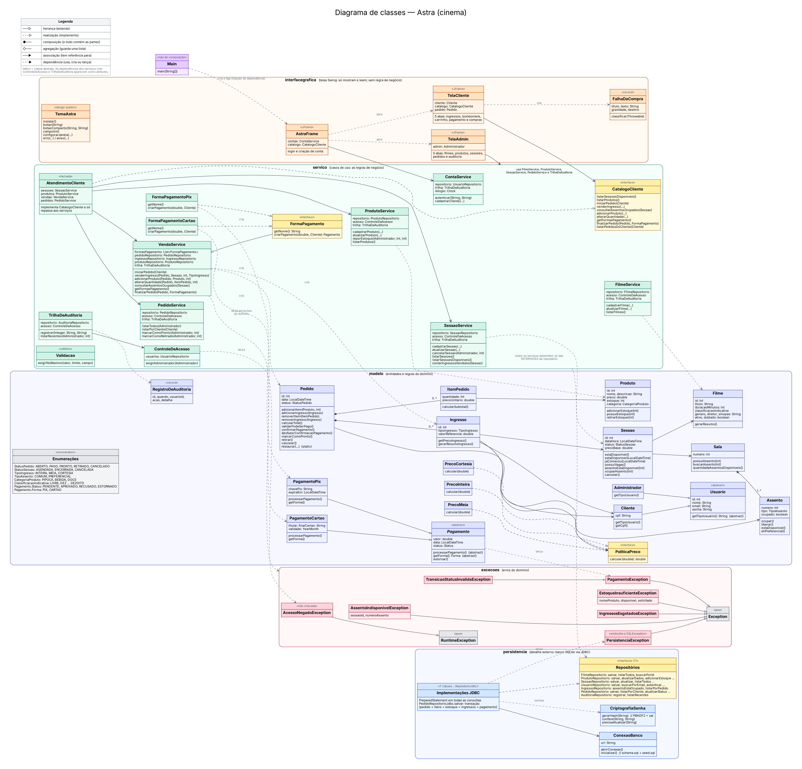
 
**Diagrama de casos de uso**
 
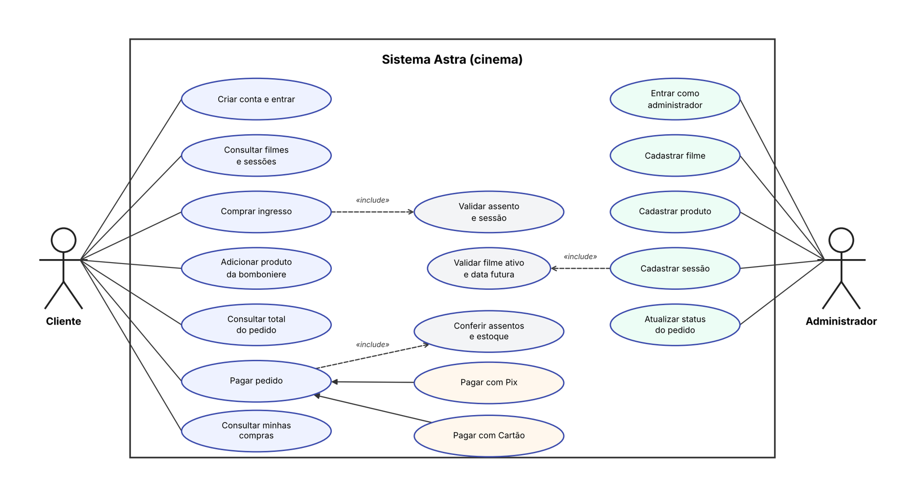
 
**Diagrama Entidade-Relacionamento (DER) do banco**
 
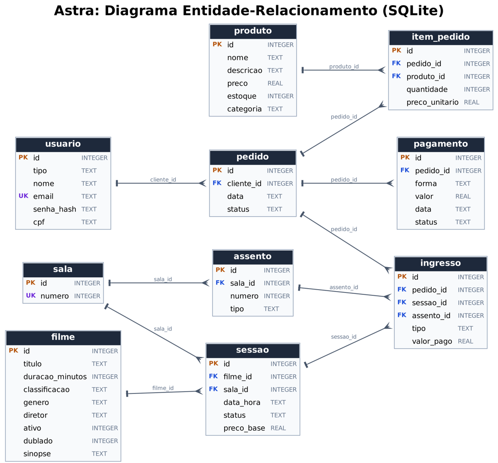
 
## Demonstração da Interface Gráfica
 
Capturas de tela do sistema em funcionamento (pasta [`docs/prints/`](docs/prints/)):
 
**Início e criação de conta**
 
| Tela inicial | Criar conta |
|---|---|
| 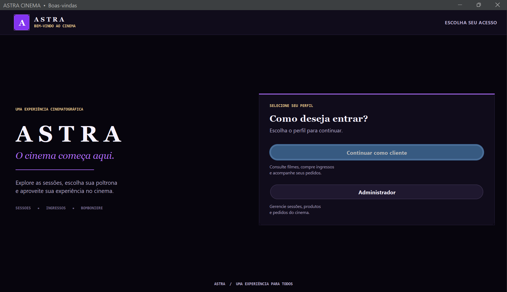 | 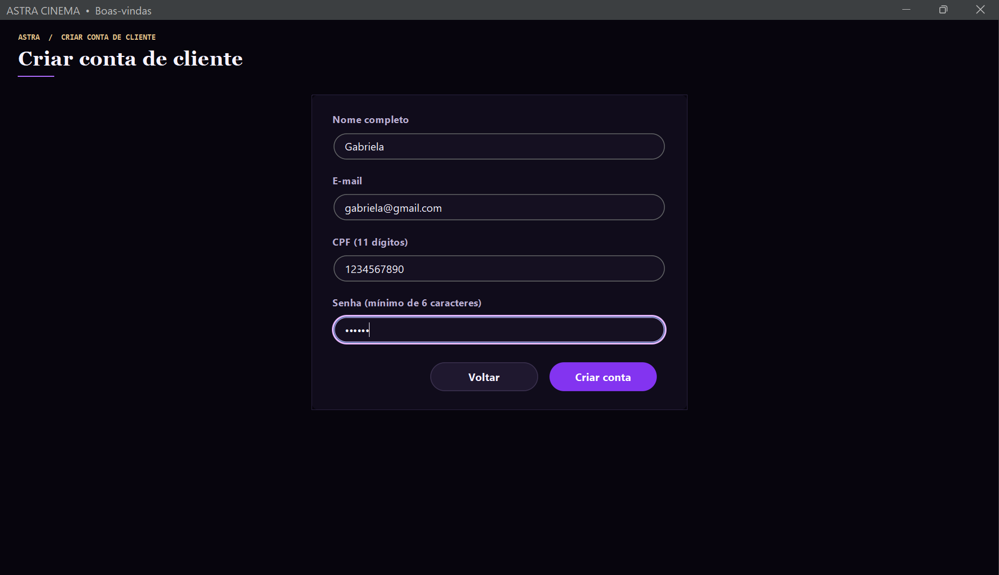 |
 
**Área do Cliente**
 
| Escolha de ingresso e poltrona | Bomboniere |
|---|---|
| 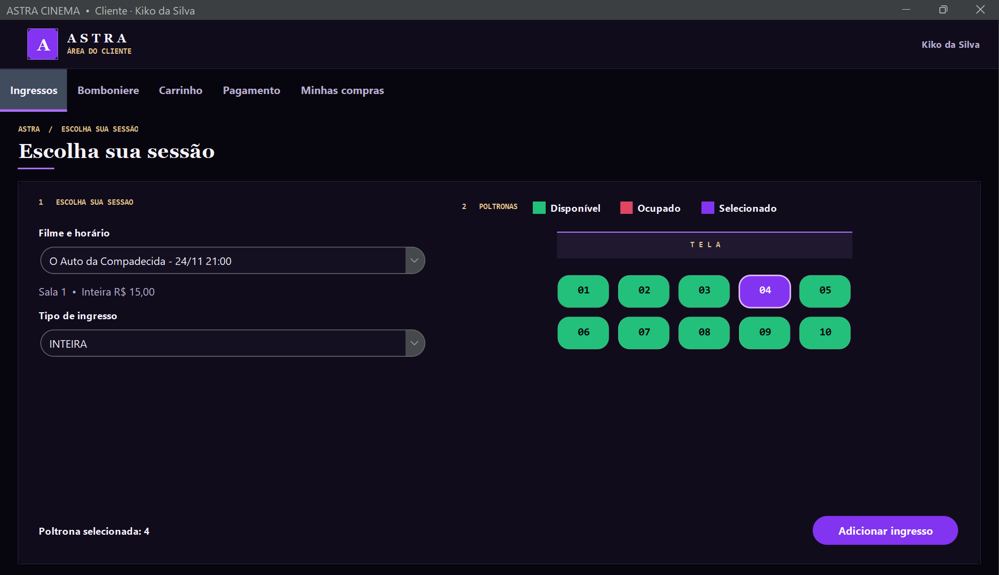 | 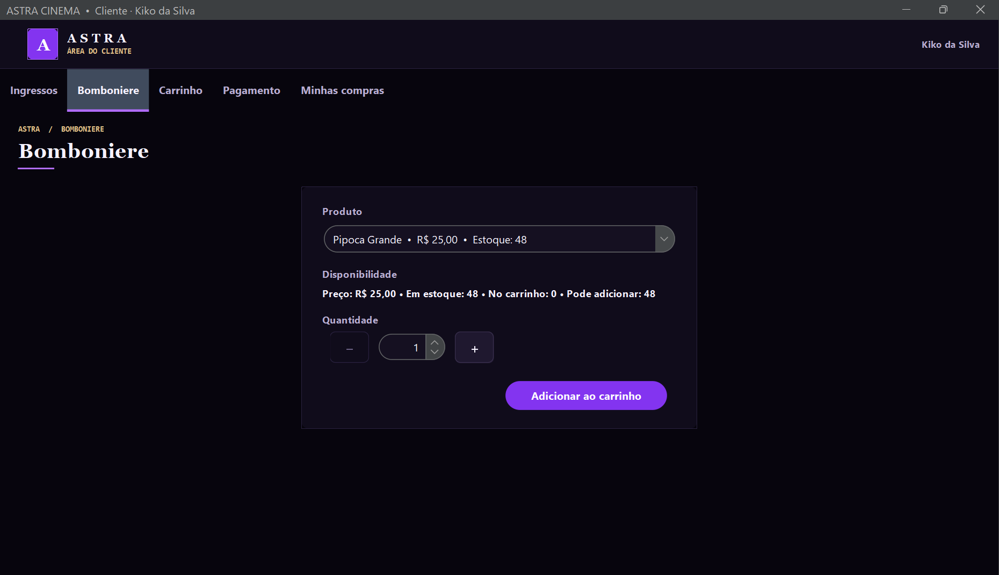 |
 
| Carrinho | Pagamento |
|---|---|
| 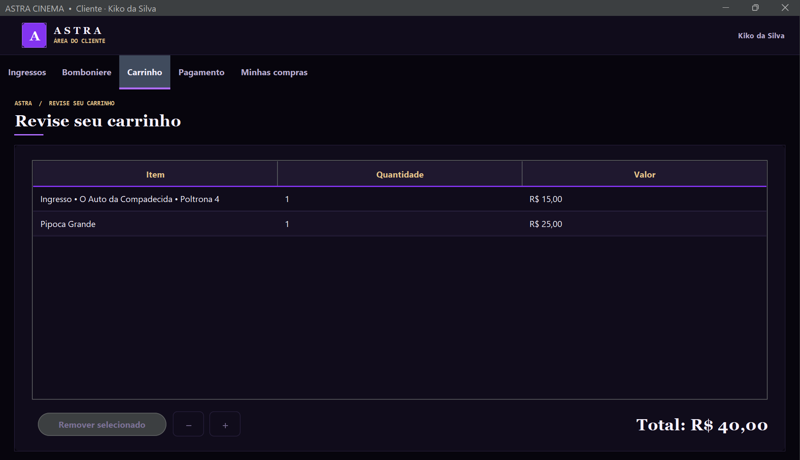 | 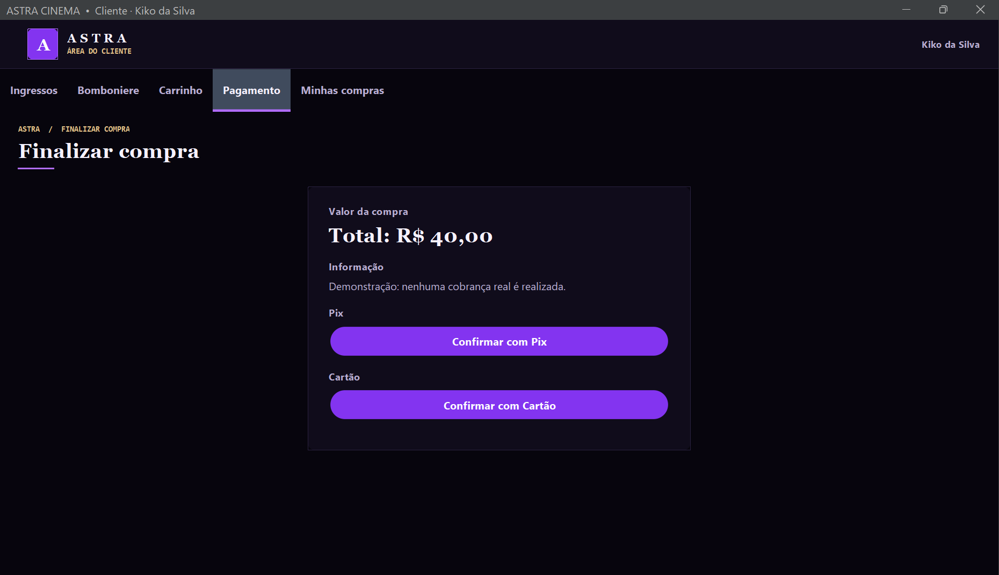 |
 
| Minhas compras | Erro tratado (assento ocupado) |
|---|---|
| 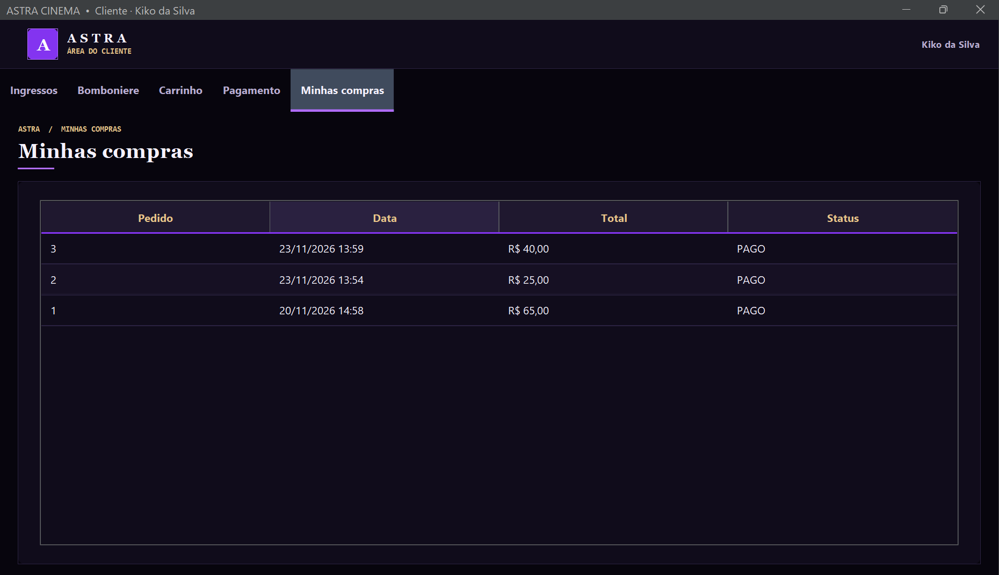 | 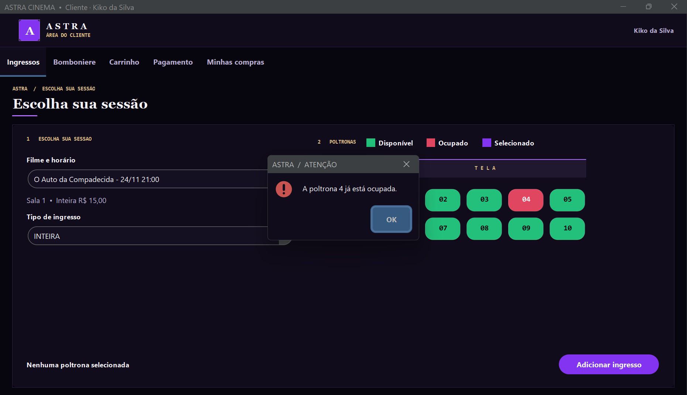 |
 
**Área do Administrador**
 
| Filmes | Janela de edição de filme |
|---|---|
| 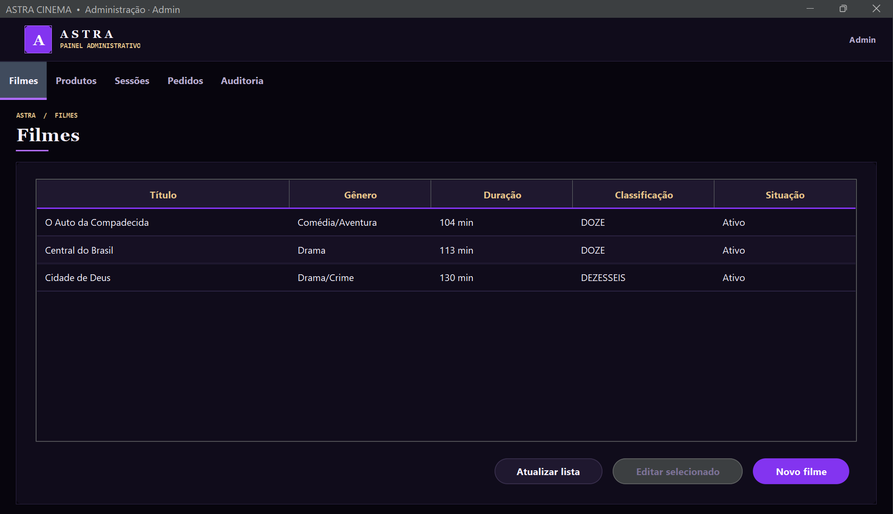 | 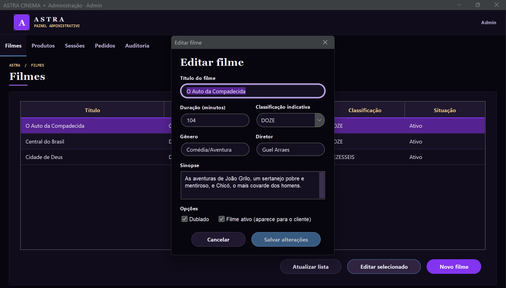 |
 
| Produtos | Sessões |
|---|---|
| 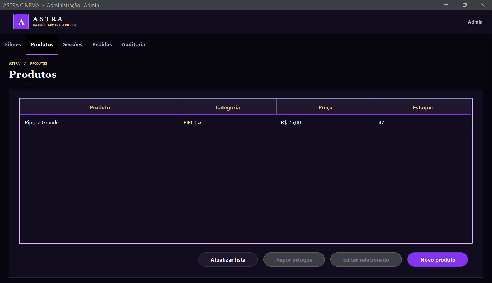 | 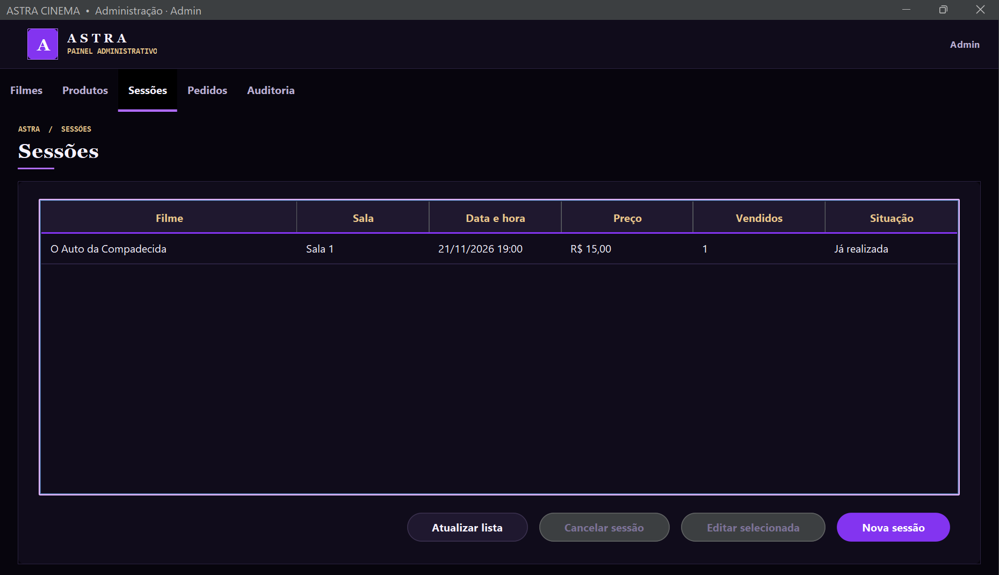 |
 
| Pedidos |
|---|
| 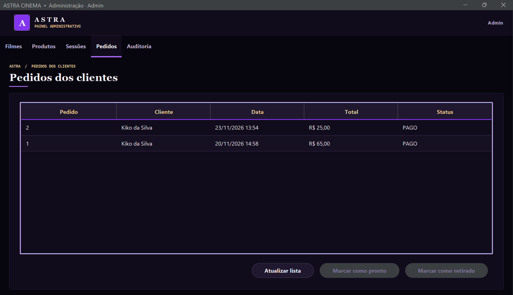 |