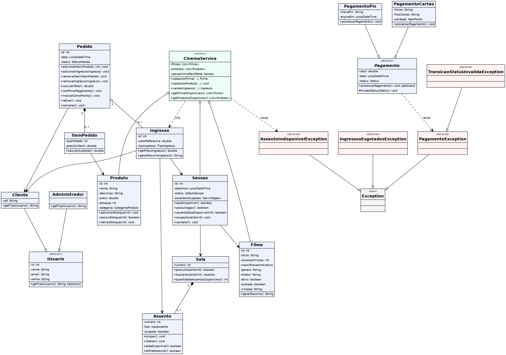
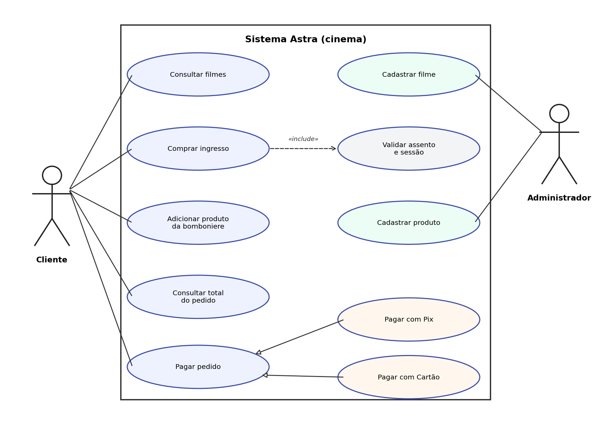
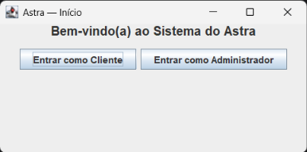
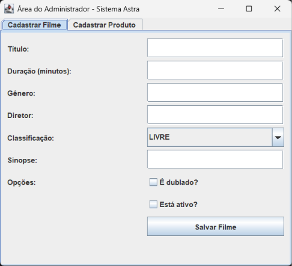
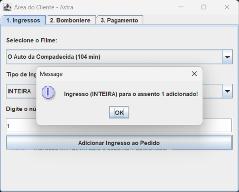
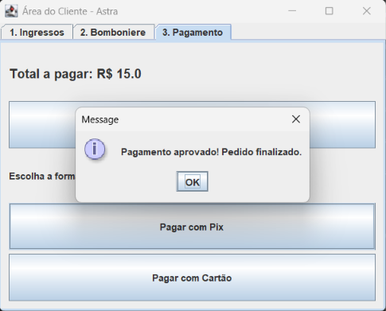
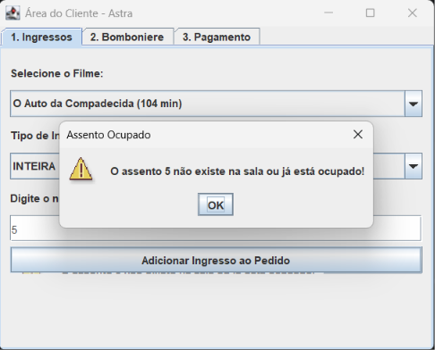

Bem-vindo ao repositório do **Grupo 7** para a disciplina de Programação Orientada a Objetos.

Nosso projeto é o Astra: um sistema de gerenciamento e compra online para um cinema. O cliente pode consultar filmes e sessões disponíveis, selecionar assentos, comprar ingressos e adquirir produtos da bomboniere. O pagamento é realizado pelo sistema e os produtos e ingressos são retirados presencialmente no cinema. Funcionários administradores podem cadastrar filmes e produtos da bomboniere. Nesta versão, a sala e a sessão de exibição são pré-cadastradas no `CinemaService` para a demonstração.

---

## Integrantes do Grupo

* **Bruna Rosa Ferreira** — brunarf.aluno@unipampa.edu.br — [GitHub](https://github.com/eumuno)
* **Erik Bruckmann Soares** — eriksoares.aluno@unipampa.edu.br — [GitHub](https://github.com/Erikbruckmann1)
* **Gabriela Muniz Barreto** — gabrielamuniz.aluno@unipampa.edu.br — [GitHub](https://github.com/gabrielamnzb)
* **Isabeli Souza da Rosa** — isabelirosa.aluno@unipampa.edu.br — [GitHub](https://github.com/beliisa2626)
* **Katiane Gamarra Olegário** — katianeolegario.aluno@unipampa.edu.br — [GitHub](https://github.com/katianeG)

---

## Estrutura de Pastas do Repositório

A organização física das pastas do repositório segue as recomendações de boas práticas de engenharia de software:

```
poo-astra/
├── README.md                   # Esta página inicial do projeto.
├── docs/                       # Pasta para documentos gerais.
├── diagramas/                  # Pasta para os diagramas UML.
├── lib/                        # Bibliotecas externas (driver JDBC do SQLite).
└── src/                        # Pasta raiz do código-fonte.
    └── astra/                  
        ├── modelo/             # Classes de domínio.
        ├── servico/            # Regras de negócio e lógicas do sistema.
        ├── excecoes/           # Classes de erros personalizados do domínio.
        ├── persistencia/       # Acesso ao banco de dados (ConexaoBanco).
        │   └── sql/            # schema.sql (tabelas) e seed.sql (dados iniciais).
        └── interfacegrafica/   # Telas desenvolvidas em Java Swing.              
```
## Instruções para Executar o Projeto

Para testar o sistema Astra localmente, siga os passos abaixo:
1. Faça o clone deste repositório em sua máquina.
2. Tenha o **JDK 11 ou superior** instalado.
3. Abra o projeto em sua IDE de preferência (IntelliJ IDEA, Eclipse ou NetBeans), marcando a pasta `src` como raiz do código-fonte.
4. Adicione o driver do banco ao projeto: o arquivo `lib/sqlite-jdbc-3.46.1.3.jar` já está no repositório.
   * **IntelliJ:** *File → Project Structure → Libraries → + → Java* e selecione o `.jar` da pasta `lib/` (ou clique com o botão direito no `.jar` → *Add as Library*).
   * **Eclipse:** botão direito no projeto → *Build Path → Add External Archives* → selecione o `.jar`.
   * **NetBeans:** *Libraries → Add JAR/Folder* → selecione o `.jar`.
5. Execute a classe `astra.Main` (arquivo `src/astra/Main.java`) com a **raiz do projeto como diretório de trabalho** (padrão do IntelliJ).
6. Na primeira execução é criado o arquivo `astra.db` na raiz do projeto, com as tabelas e os dados iniciais. Nas próximas, os dados existentes são mantidos. Para recomeçar do zero, feche o programa e apague o `astra.db`.
7. A tela inicial (`AstraFrame`) será aberta. Você pode navegar entre a Área do Administrador (para cadastrar Filmes e Produtos) e a Área do Cliente (para simular uma compra completa de ingressos e produtos da bomboniere, finalizando no pagamento).

**Pela linha de comando** (na raiz do projeto; no Windows troque `:` por `;` no classpath):

```bash
javac -encoding UTF-8 -d out $(find src -name "*.java")
```

```bash
java -cp "out:lib/sqlite-jdbc-3.46.1.3.jar" astra.Main
```

Se o driver não estiver no classpath, o sistema mostra a mensagem "Não foi possível conectar ao banco de dados" e não abre.

## Banco de Dados

Usamos **SQLite** via JDBC: o banco é um único arquivo (`astra.db`), sem precisar instalar servidor.

* **`ConexaoBanco`** (`astra.persistencia`): ponto único de acesso ao banco. `abrirConexao()` devolve uma `Connection` com as chaves estrangeiras ligadas (`PRAGMA foreign_keys = ON`); `inicializar()` executa o `schema.sql` e, se o banco estiver vazio, o `seed.sql`, tudo em uma transação. A URL pode ser trocada com `-Dastra.banco.url=jdbc:sqlite:outro.db`.
* **`schema.sql`**: cria as tabelas `usuario`, `filme`, `sala`, `assento`, `sessao`, `produto`, `pedido`, `item_pedido`, `ingresso` e `pagamento`. Os ids são gerados pelo banco (`AUTOINCREMENT`), os enums são gravados como texto (`name()`) com `CHECK` para aceitar só valores válidos, e as datas em ISO-8601 (`LocalDateTime.toString()`).
* **`seed.sql`**: dados iniciais (o filme, o produto, a sala com 10 assentos e a sessão que antes ficavam no construtor do `CinemaService`, além de um administrador e um cliente).
* **`PersistenciaException`** (`astra.excecoes`): embrulha a `SQLException`, para que serviços e telas tratem erros de banco como as demais exceções do sistema.
* **`CriptografiaSenha`** (`astra.persistencia`): as senhas são gravadas como hash SHA-256, nunca em texto puro.

Regras garantidas pelo próprio banco:
* `UNIQUE(sessao_id, assento_id)` em `ingresso`: o mesmo assento não pode ser vendido duas vezes na mesma sessão.
* `CHECK (estoque >= 0)` em `produto`: o estoque nunca fica negativo.
* Chaves estrangeiras: não é possível, por exemplo, criar um pedido para um cliente que não existe.

Usuários iniciais (senha `123` para ambos): `admin@astra` (administrador) e `cliente@email.com` (cliente).

### Como usar o banco

**Onde fica:** o arquivo `astra.db` é criado na pasta de onde o programa é executado (no IntelliJ, a raiz do projeto). Ele está no `.gitignore`, então cada integrante tem o seu próprio banco local.

**Quando o `seed.sql` roda:** só na primeira execução, quando a tabela `usuario` ainda está vazia. Nas execuções seguintes o seed é ignorado, para não duplicar dados.

> ⚠️ Se você **alterar o `seed.sql`** (por exemplo, adicionar um filme), a mudança **não** entra em um `astra.db` que já existe. Para aplicar:
> 1. Feche o programa.
> 2. Apague o `astra.db` da raiz do projeto (`rm astra.db` no macOS/Linux, `del astra.db` no Windows).
> 3. Execute o `astra.Main` de novo. O banco é recriado com o schema e o seed atualizados.
>
> Isso apaga tudo o que foi gravado no banco local.

**Quando o `schema.sql` roda:** a cada execução, mas com `CREATE TABLE IF NOT EXISTS`. Uma tabela nova é criada normalmente. Já uma **mudança em tabela existente** (coluna nova, `CHECK` diferente) só vale depois de apagar o `astra.db`, como acima.

**Como ver os dados:**
* **Linha de comando** (o `sqlite3` já vem no macOS e na maioria das distribuições Linux):
  ```bash
  sqlite3 astra.db
  sqlite> .tables
  sqlite> .headers on
  sqlite> .mode column
  sqlite> SELECT * FROM filme;
  sqlite> .quit
  ```
* **IntelliJ:** abra a aba *Database → + → Data Source → SQLite*, aponte para o arquivo `astra.db` da raiz do projeto e, se o IntelliJ pedir, baixe o driver. Depois de rodar o programa, use *Refresh* para ver os dados atualizados.
* **Outra opção gráfica:** [DB Browser for SQLite](https://sqlitebrowser.org/).

**Usar outro arquivo de banco** (por exemplo, para testes sem mexer no seu `astra.db`): adicione `-Dastra.banco.url=jdbc:sqlite:teste.db` às *VM options* da configuração de execução no IntelliJ, ou rode pela linha de comando:

```bash
java -Dastra.banco.url=jdbc:sqlite:teste.db -cp "out:lib/sqlite-jdbc-3.46.1.3.jar" astra.Main
```

**Problemas comuns:**
* *"Não foi possível conectar ao banco de dados"*: o `lib/sqlite-jdbc-3.46.1.3.jar` não está no classpath (veja o passo 4 das instruções de execução).
* *"Script sql/schema.sql não encontrado"*: o programa não foi executado a partir da raiz do projeto. Ajuste o *Working directory* da configuração de execução para a pasta `poo-astra`.
* *Mudei o seed e nada aconteceu*: apague o `astra.db` (veja o aviso acima).
* *Os dados novos estão no banco mas não aparecem nas telas*: ainda é esperado. Veja o estado atual abaixo.

> **Estado atual:** a estrutura do banco está pronta e é criada ao abrir o sistema. Os repositórios que vão ler e gravar filmes, produtos, sessões e pedidos nessas tabelas ainda estão em desenvolvimento; até lá, as telas continuam usando os dados em memória do `CinemaService`.

## Identificação das Classes Principais

O nosso domínio foi modelado para refletir a realidade de um cinema. As classes principais estão divididas em:

* **Atores:** `Usuario` (abstrata), `Cliente` e `Administrador`. Representam quem interage com o sistema.
* **Cinema:** `Filme`, `Sessao`, `Sala` e `Assento`. Representam a estrutura física e a programação.
* **Vendas:** `Produto`, `ItemPedido`, `Pedido` e `Ingresso`. Representam o ciclo de compras do cliente.
* **Pagamento:** `Pagamento` (abstrata), `PagamentoPix` e `PagamentoCartao`. Representam as diferentes formas de processar o acerto financeiro do pedido.
* **Serviço Central:** `CinemaService`. Classe que atua como o coordenador do caso de uso, validando regras de negócio e armazenando os dados em listas na memória para a execução do sistema.

## Explicação Breve das Regras de Negócio

O sistema não é apenas um cadastro; ele protege ativamente as seguintes regras de negócio:
* **Controle de Vagas:** Um assento não pode ser vendido se já estiver ocupado (dispara `AssentoIndisponivelException`).
* **Validação de Sessão:** O sistema impede a venda de ingressos para sessões que não estejam disponíveis (dispara `IllegalStateException`).
* **Imutabilidade do Pedido:** Um pedido vazio não pode ser pago, e um pedido que já foi finalizado não pode ter seu status alterado livremente ou ser cancelado diretamente de forma indevida.
* **Regras de Pagamento:** Cartões com `YearMonth` de validade expirada são automaticamente recusados, e transações Pix fora do prazo expiram, bloqueando a transição de status (dispara `PagamentoException`).

## Checklist de Avaliação

Abaixo, detalhamos onde cada conceito exigido foi aplicado no nosso sistema:

| Conceito | O que deve ser demonstrado | Como o projeto cumpriu o item |
|---|---|---|
| Classes e objetos Java | Classes coerentes e instanciação de objetos do domínio | Instanciação de `Filme`, `Cliente`, `Produto` e `Ingresso` nas operações do sistema. |
| Atributos de classe Java | Estado relevante armazenado nos objetos | Atributos como `titulo` e `duracaoMinutos` em `Filme`, e `estoque` em `Produto`. |
| Métodos de classe Java | Comportamentos associados às classes corretas | Métodos como `calcularTotal()` no `Pedido` e `ocupar()` no `Assento`. |
| Construtores em Java | Inicialização obrigatória e criação de objetos válidos | Construtores de `Filme`, `Usuario` e `Sessao` exigem a passagem dos dados obrigatórios na sua criação. |
| Palavra-chave `this` | Referência inequívoca ao objeto atual | Utilizado amplamente nos construtores (ex: `this.nome = nome`) para diferenciar atributos de parâmetros. |
| Modificadores Java | Visibilidade adequada de classes, atributos e métodos | Atributos declarados como `private` (e `final` para imutabilidade no `ItemPedido`), expondo apenas `public getters`. |
| Encapsulamento em Java | Proteção do estado e alterações por métodos controlados | O atributo `ocupado` de `Assento` não pode ser alterado externamente, apenas pelo método `ocupar()`. |
| Pacotes Java / API | Organização do código por responsabilidade | Código rigorosamente dividido em `modelo`, `servico`, `excecoes` e `interfacegrafica`. |
| Herança em Java | Especialização coerente de um conceito geral | `Cliente` e `Administrador` estendem `Usuario`; `PagamentoPix` e `PagamentoCartao` estendem `Pagamento`. |
| Polimorfismo em Java | Uso do tipo geral para manipular objetos diferentes | Em `TelaCliente`, o método `processarPagamentoPolimorfico(Pagamento)` recebe o tipo geral e chama `processarPagamento()`, sem saber se é `PagamentoPix` (valida o prazo de 10 minutos) ou `PagamentoCartao` (valida a validade do cartão). |
| Palavra-chave `super` | Reaproveitamento da inicialização ou comportamento da superclasse | Construtores de `Cliente`, `Administrador` e `PagamentoCartao` chamam `super(...)` para aproveitar os dados da classe mãe. |
| Abstração em Java | Representação de um conceito geral que não deve ser instanciado diretamente | As classes `Usuario` e `Pagamento` foram declaradas como `abstract`. |
| Interfaces em Java | Contrato com implementações substituíveis | Não criamos uma `interface` própria: o contrato substituível do domínio foi representado pela classe abstrata `Pagamento`, pois Pix e Cartão compartilham estado (valor, data, status). Usamos interfaces da API Java, como `List` e `Set`. Uma evolução natural seria extrair uma `PoliticaPreco` para os tipos de ingresso. |
| Enum em Java | Conjunto fechado de valores válidos | Uso extensivo para segurança de estado: `TipoIngresso`, `StatusPedido`, `Pagamento.Status`, `statusSessao`, `tipoAssento`, `classificacaoIndicativa` e `CategoriaProduto`. |
| Tratamento de exceções em Java | Lançamento e tratamento adequado de erros, incluindo exceções próprias do domínio | Criação das exceções `AssentoIndisponivelException` e `PagamentoException`, lançadas pelo domínio e capturadas/exibidas via `try-catch` no Java Swing. |
| Interface gráfica com Swing | Interface mínima funcional para entrada, execução de operações e apresentação de resultados | Telas completas (`AstraFrame`, `TelaCliente`, `TelaAdmin`) usando `JFrame`, `JComboBox`, `JTextField` e exibições amigáveis via `JOptionPane`. |
| Data e hora em Java | Uso da API `java.time` | Uso de `LocalDateTime` para a data/hora da `Sessao` e do `Pedido`, e `YearMonth` para a validade do `PagamentoCartao`. |

## Diagramas

Os diagramas UML estão na pasta [`diagramas/`](diagramas/).

**Diagrama de classes**



**Diagrama de casos de uso**



## Demonstração da Interface Gráfica

Capturas de tela do sistema em funcionamento (pasta [`docs/prints/`](docs/prints/)):

| Tela inicial | Área do Administrador |
|---|---|
|  |  |

| Compra de ingresso | Pagamento |
|---|---|
|  |  |

| Erro tratado (assento ocupado) |
|---|
|  |
